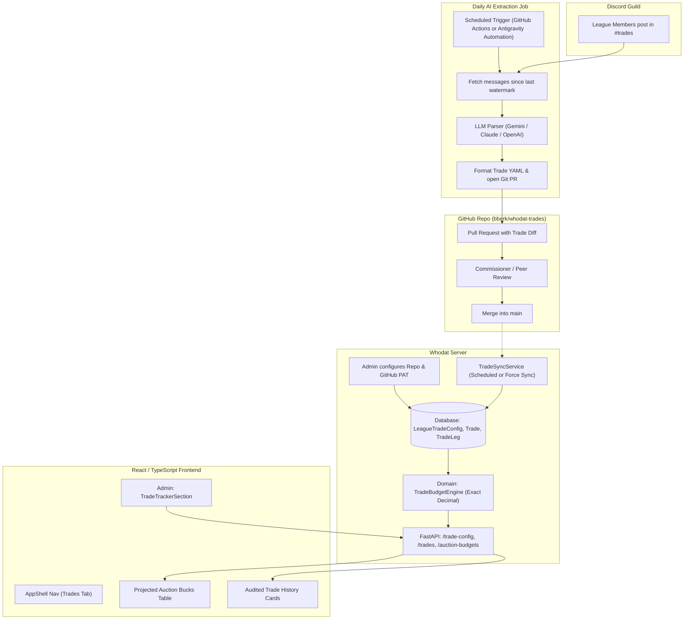
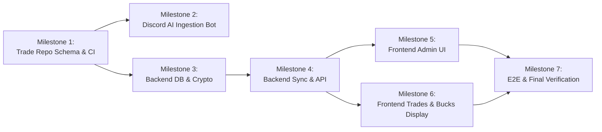

# Implementation Plan: Discord Trade Tracker & Projected Auction Bucks

**Branch:** `discord_trade_tracker_plan`
**Status:** Draft / For Review
**Target Systems:** Discord, `bberk/whodat-trades` (GitHub), `whodat-server` (Backend & Frontend)

---

## 1. Executive Summary & High-Level Architecture

Fantasy football dynasty and keeper leagues frequently trade future assets—most notably **auction draft dollars** and future draft picks—often via Discord text chat in channels like `#trades`. Currently, fantasy platforms like ESPN do not natively support future auction budget modifications or tracking across seasons.

This feature introduces an end-to-end, opt-in **Trade Tracker & Projected Auction Bucks Display** system:
1. **Discord Ingestion & AI Parsing**: An automated job monitors `#trades`, extracts completed trades and conditional clauses using an LLM, and submits them as Pull Requests to a dedicated Git repository (`bberk/whodat-trades`).
2. **Human-in-the-Loop Review**: League managers or commissioners review the PR diff on GitHub for accuracy and merge it into `main`.
3. **Whodat Server Sync**: The `whodat-server` backend fetches the merged trade ledger from GitHub using an encrypted token, calculates each team's net auction dollars adjustment, and computes projected auction budgets.
4. **Website Display**: The frontend displays a rich, interactive **Projected Auction Bucks Table** alongside an audited **Trade History Feed**, with full admin controls for budget baselines and sync triggers.

### System Architecture Flow



---

## 2. Subsystem 1: Discord AI Trade Extraction Engine

### 2.1 Trigger & Execution Environment

The AI job must run on a regular schedule (e.g., daily at 08:00 UTC, or every 6 hours during trading season). We evaluate two deployment options:

| Criteria | Option A: Scheduled GitHub Action (Recommended) | Option B: Antigravity Scheduled Automation / Local Daemon |
| :--- | :--- | :--- |
| **Hosting** | Headless in GitHub cloud runner. | Runs on user's Mac via local cron/launchd/Antigravity. |
| **Uptime & Reliability** | 99.9% uptime; does not depend on local laptop being awake or online. | Suspended if laptop sleeps or loses internet connection. |
| **Secrets Management** | Stored securely in GitHub Repository Secrets (`DISCORD_BOT_TOKEN`, `GEMINI_API_KEY`, `GH_PAT`). | Stored in local environment or macOS Keychain. |
| **Access to Target Repo** | Native `GITHUB_TOKEN` or Repo PAT with write permissions. | Requires local Git / GitHub CLI auth. |
| **Maintenance** | Zero hardware management; automatic run logs in GitHub UI. | Requires monitoring local daemon processes. |

> [!TIP]
> **Recommendation:** Deploy as a **Scheduled GitHub Action** within the `bberk/whodat-trades` repository (or a companion workflow repository). A local Antigravity automation script (`scripts/sync_discord_trades.py`) should also be provided for manual on-demand execution and debugging.

### 2.2 Discord Ingestion & Watermarking

1. **Bot Permissions**: A lightweight Discord bot application with `View Channels` and `Read Message History` permissions in `#trades`.
2. **State & Watermark**:
   - The job stores the `last_processed_message_id` (watermark) in a root file in `bberk/whodat-trades` named `.watermark.json`:
     ```json
     {
       "channel_id": "123456789012345678",
       "last_message_id": "130458923485723490",
       "last_sync_timestamp": "2026-11-07T12:00:00Z"
     }
     ```
   - On each run, the bot calls Discord REST API:
     `GET /channels/{channel_id}/messages?after={last_message_id}&limit=100`.
   - Messages are paginated chronologically forward.

### 2.3 LLM Extraction Pipeline & Nuances

Discord trade channels present several parsing challenges:
- **Informal trade language**: *"I give Mahomes + 15 bucks for JJ"*, *"Trading away Henry for 2027 $20"*, *"Confirmed"*, *"Deal"*.
- **Multi-message context**: Manager A posts the trade proposal; Manager B replies *"Accept"* or reacts with a `white_check_mark` or `thumbsup`.
- **Target Draft Year Ambiguity**: If a trade occurs in November 2026 for *"auction dollars"*, it usually applies to the **2027 draft**. If specified as *"2028 bucks"*, it applies to 2028.
- **Conditional Clauses**: *"If JJ finishes as WR1, Team B sends an additional $5 in 2027"*.
- **Non-trade Chatter**: Trash talk, trade blocks, counter-offers, and banter must be classified as `is_trade: false` and discarded.

#### LLM Extraction Prompt & Schema
The prompt instructs the LLM to output strictly formatted JSON conforming to the trade schema:

```json
{
  "trades_found": [
    {
      "source_message_id": "130458923485723490",
      "source_jump_url": "https://discord.com/channels/.../...",
      "timestamp": "2026-11-07T16:30:00Z",
      "confirmed": true,
      "target_draft_year": 2027,
      "parties": [
        {
          "team_name": "Team Alice",
          "discord_author": "alice_ff",
          "players_sent": ["Patrick Mahomes"],
          "players_received": ["Justin Jefferson"],
          "auction_dollars_delta": -15
        },
        {
          "team_name": "Team Bob",
          "discord_author": "bob_commish",
          "players_sent": ["Justin Jefferson"],
          "players_received": ["Patrick Mahomes"],
          "auction_dollars_delta": 15
        }
      ],
      "conditions": [
        {
          "description": "If Patrick Mahomes wins Super Bowl MVP, Team Bob pays an extra $5 in 2027 auction dollars",
          "target_draft_year": 2027,
          "potential_delta": 5,
          "paying_team": "Team Bob",
          "receiving_team": "Team Alice",
          "status": "pending"
        }
      ],
      "raw_text": "Alice: Patrick Mahomes + $15 2027 for Justin Jefferson\nBob: Accepted"
    }
  ]
}
```

### 2.4 Pull Request Generation

When one or more valid, confirmed trades are identified:
1. The action creates a new git branch: `trade/sync-YYYY-MM-DD-HHMM`.
2. Formats and writes the trade files (and updates `.watermark.json`).
3. Opens a Pull Request against `main` using `gh pr create` with:
   - **Title**: `Trade Log: <Team A> / <Team B> (YYYY-MM-DD)`
   - **Body**: Detailed summary table of incoming/outgoing assets, auction dollar changes, quotes of the Discord messages, and direct links to the Discord posts.
   - **Reviewer Assignment**: Tag the commissioner or trade review committee.

---

## 3. Subsystem 2: Trade Repository Architecture (`bberk/whodat-trades`)

### 3.1 Repository Structure Options Comparison

We analyze three structural approaches for `bberk/whodat-trades`:

```
Option 1: One File Per Trade (Year-partitioned)
trades/
  2026/
    2026-10-15_mahomes_jefferson.yaml
    2026-11-02_henry_picks.yaml
  2027/
    ...

Option 2: Single File Per Draft Year
seasons/
  2026_trades.yaml
  2027_trades.yaml

Option 3: Hybrid (File-Per-Trade + Auto-Compiled Ledger via CI)
trades/
  2026/
    2026-10-15_mahomes_jefferson.yaml
ledger.json          <-- generated on push to main
```

| Criteria | Option 1: File Per Trade | Option 2: Single File Per Year | Option 3: Hybrid (Recommended) |
| :--- | :--- | :--- | :--- |
| **Merge Conflicts** | **None.** Multiple trades can be opened and merged concurrently. | **High.** Concurrent trades edit the same file, causing merge conflicts. | **None on PR.** CI re-compiles the index on merge to `main`. |
| **PR Review Experience** | Clean, isolated diff. Easy to inspect on desktop or mobile. | Growing diff file with potential clutter. | Clean, isolated diff on PR. |
| **Multi-Year Trades** | Single trade affecting multiple years stays atomic in one file. | Awkward: trade must be duplicated or split across files. | Atomic trade record in one file. |
| **Server Ingestion Simplicity** | Requires fetching multiple files via GitHub Tree API. | Requires fetching only one file per season. | **Easiest.** Server fetches `ledger.json` in a single HTTP request. |
| **Auditability & Rollback** | Reverting a trade is a simple `git rm` or commit revert. | Requires manual editing of lines within the year file. | Reverting a trade is a simple `git rm`. |

> [!IMPORTANT]
> **Decision: Adopt Option 3 (Hybrid Approach)**
> - Each trade is committed as an independent YAML file under `trades/<agreement_year>/<date>_<slug>.yaml`.
> - A lightweight GitHub Action in `bberk/whodat-trades` runs on every PR to validate schema, and on merge to `main` compiles `ledger.json` (a consolidated manifest of all trades and calculated net balances).

### 3.2 Canonical Trade Schema (`trades/YYYY/YYYY-MM-DD_<slug>.yaml`)

```yaml
version: 1
id: "2026-11-07-alice-bob"
date: "2026-11-07T16:30:00Z"
agreement_season: 2026
target_draft_year: 2027
source:
  platform: "discord"
  channel: "trades"
  message_id: "130458923485723490"
  jump_url: "https://discord.com/channels/123/456/130458923485723490"
parties:
  - team_name: "Team Alice"
    discord_user: "alice_ff"
    auction_dollars_delta: -15.00
    players_sent:
      - name: "Patrick Mahomes"
        position: "QB"
        nfl_team: "KC"
    players_received:
      - name: "Justin Jefferson"
        position: "WR"
        nfl_team: "MIN"
  - team_name: "Team Bob"
    discord_user: "bob_commish"
    auction_dollars_delta: 15.00
    players_sent:
      - name: "Justin Jefferson"
        position: "WR"
        nfl_team: "MIN"
    players_received:
      - name: "Patrick Mahomes"
        position: "QB"
        nfl_team: "KC"
conditions:
  - id: "cond-1"
    description: "If Patrick Mahomes wins Super Bowl MVP, Team Bob pays extra $5 in 2027"
    target_draft_year: 2027
    paying_team: "Team Bob"
    receiving_team: "Team Alice"
    amount: 5.00
    status: "pending" # pending | fulfilled | void
notes: |
  Agreed in #trades on Nov 7. Confirmed by both managers with thumbsup reaction.
```

### 3.3 Zero-Sum Balance Constraint
The CI workflow in the trade repo verifies that for any trade:
$$\sum_{p \in \text{parties}} \text{auction\_dollars\_delta}_p = 0$$
Auction dollars cannot be created or destroyed out of thin air in a trade.

---

## 4. Subsystem 3: Whodat Server Integration Architecture

### 4.1 Opt-in Configuration & Database Models

To maintain clean module boundaries and follow existing repository patterns (e.g., `LeagueEloConfig`), we introduce `LeagueTradeConfig`, `LeagueTrade`, and `LeagueTradeParty`.

#### Alembic Migration: `0012_trade_tracker.py`

```python
"""Add league trade tracking and projected auction budget tables."""

# Tables:
# 1. league_trade_config
#    - league_id (FK league.id, UNIQUE)
#    - enabled (Boolean, default False)
#    - repo_owner (Text, e.g. "bberk")
#    - repo_name (Text, e.g. "whodat-trades")
#    - branch (Text, default "main")
#    - github_token_encrypted (Text, nullable)
#    - base_auction_budget (Numeric(10, 2), default 200.00)
#    - team_aliases (JSON, default {})
#    - last_synced_at (DateTime(timezone=True), nullable)
#    - last_sync_commit (Text, nullable)
#    - last_sync_status (Text, default "idle") # idle | success | error
#    - last_sync_error (Text, nullable)

# 2. league_trade
#    - id (Integer, PK)
#    - league_id (FK league.id)
#    - external_trade_id (Text) # e.g. "2026-11-07-alice-bob"
#    - date (DateTime(timezone=True))
#    - agreement_season (Integer)
#    - target_draft_year (Integer)
#    - discord_url (Text, nullable)
#    - summary (Text)
#    - raw_yaml (Text)
#    - conditions_summary (Text, nullable)
#    - uq_league_trade_external_id (league_id, external_trade_id)

# 3. league_trade_party
#    - id (Integer, PK)
#    - trade_id (FK league_trade.id, ON DELETE CASCADE)
#    - owner_id (FK owner.id, nullable)
#    - team_name_raw (Text)
#    - auction_dollars_delta (Numeric(10, 2))
#    - players_sent (JSON)
#    - players_received (JSON)
```

### 4.2 Credential Security

The GitHub Personal Access Token (PAT) allows reading the private repository `bberk/whodat-trades`.
- Stored using `app.security.crypto.encrypt_credential(token)` (AES-256-GCM).
- Masked in API responses (`has_token: true`, `token_preview: "ghp_****1234"`).
- Never written to logs or sent to non-admin users.

### 4.3 GitHub Sync Service (`TradeSyncService`)

Located at `backend/src/app/services/trade_sync_service.py`:
1. **GitHub API Client**: Uses `httpx.Client` with `Authorization: Bearer <decrypted_token>`.
2. **Fetch Strategy**:
   - Primary: `GET /repos/{owner}/{repo}/contents/ledger.json?ref={branch}`.
   - Fallback / Verification: `GET /repos/{owner}/{repo}/contents/trades?ref={branch}`.
   - Header `If-None-Match` with commit SHA / ETag prevents unnecessary re-downloads.
3. **Team Resolution & Alias Matching**:
   - Trade files contain names like `"Team Alice"` or `"alice_ff"`.
   - The sync service matches names against:
     1. Exact match on `Owner.display_name` or `Team.name`.
     2. Configured aliases in `league_trade_config.team_aliases` (e.g. `{"alice_ff": 4}`).
     3. If unmapped, associates party with `owner_id = None` and flags an unmapped alias alert for the admin.
4. **Rate Limiting**:
   - Sync requests triggered by the admin "Sync Now" button are rate-limited using a bucket pattern (max 1 sync per 30 seconds per league).

### 4.4 Domain Engine: Projected Auction Budget (`app.domain.trade_budget`)

Strict adherence to repository standards:
- **Zero float arithmetic**: Uses `Decimal` quantized to 2 decimal places.
- Pure domain logic with 100% test coverage.

**Calculation Formula for a Given Target Draft Year $Y$:**
$$\text{Starting Budget} = \text{base\_auction\_budget}\quad (\text{e.g., } \$200.00)$$
$$\text{Net Trade Delta}_i = \sum_{t \in \text{Trades}_Y} \text{auction\_dollars\_delta}_{i, t}$$
$$\text{Projected Auction Budget}_i = \text{Starting Budget} + \text{Net Trade Delta}_i$$
$$\text{Potential Conditional Delta}_i = \sum_{c \in \text{PendingConditions}_{i, Y}} \text{conditional\_amount}_{i, c}$$

### 4.5 API Contract & Endpoints

All endpoints are prefixed with `/api/v1` and documented in `docs/openapi.json`:

| Method | Endpoint | Auth | Description |
| :--- | :--- | :--- | :--- |
| `GET` | `/leagues/{league_id}/trade-config` | Admin | Get trade tracker configuration, sync status, and team mappings. |
| `PUT` | `/leagues/{league_id}/trade-config` | Admin | Update repo, token, base budget, and team aliases. |
| `POST` | `/leagues/{league_id}/trades/sync` | Admin | Force trigger a fresh sync from GitHub. |
| `GET` | `/leagues/{league_id}/trades` | Member | List trade history log with search/filter by team and year. |
| `GET` | `/leagues/{league_id}/auction-budgets` | Member | Return projected auction budgets per team for a target draft year. |

---

## 5. Subsystem 4: Frontend UI & User Experience

### 5.1 Navigation Integration
In `frontend/src/components/AppShell.tsx`:
- When `selectedLeague.has_trades_enabled === true`, the navigation bar adds a **Trades** link:
  `Standings | History | Trades | Owner | Admin`
- Route: `/leagues/:leagueId/trades`.

### 5.2 Admin Settings View (`TradeTrackerSection.tsx`)
Added to `frontend/src/pages/AdminPage.tsx`:
- **Toggle switch**: "Enable Trade Tracker & Auction Budget".
- **GitHub Repository Fields**:
  - Repo Name: `bberk/whodat-trades`
  - Branch: `main`
  - Personal Access Token: Password input with "Update" capability.
- **Base Starting Budget**: Number input (default `$200.00`).
- **Team Name Mapping Table**:
  - Displays any unmapped team names detected in recent trades.
  - Dropdown to associate each raw Discord name with an official League Owner.
- **Sync Status Panel**:
  - Shows: "Last synced: 10 minutes ago (commit `7b3e1a`)", Status: `Success`.
  - Button: `Sync from GitHub` (with loading spinner).

### 5.3 Dedicated Trades & Auction Page (`TradesPage.tsx`)
A responsive, mobile-first view organized into two coordinated tabs:

#### Tab A: Projected Auction Bucks Table
- **Controls**: Draft Year Selector (e.g. `2027 Auction Budget`, `2028 Auction Budget`).
- **Table Columns**:
  1. **Team / Owner**: Sticky column on mobile.
  2. **Base Starting $**: `$200.00`.
  3. **Net Trade $**: `+$15.00` (green) or `-$25.00` (rose).
  4. **Projected Budget**: **`$215.00`** (bold, highlighted).
  5. **Pending Conditions**: Badge indicating conditional upside/downside (e.g. `+$5 pending`).
  6. **Trade Count**: Number of trades affecting this season.
- **Interactive Drill-down**: Clicking a team expands or opens a modal showing all trades contributing to their budget delta.

#### Tab B: Trade Log Feed
- **Filter bar**: Search by player name, filter by team, filter by draft year.
- **Trade Card**:
  - Header: Date, Target Draft Year, Discord jump link icon.
  - Body: Two-column layout comparing Team A vs Team B assets.
  - Distinct badge for cash exchanged: `💸 $15.00 2027 Auction Bucks transferred to Team B`.
  - Conditional terms highlighted in a warning box with status indicator (`Pending`, `Fulfilled`, `Void`).
  - Expandable Discord quote showing the raw agreed message.

---

## 6. Edge Cases, Failure Modes & Handling

1. **Target Draft Year vs Current Season**:
   - Trades in week 10 of the 2026 season often trade "2027 auction money".
   - The schema explicitly separates `agreement_season` (2026) from `target_draft_year` (2027). The budget engine sums deltas strictly by `target_draft_year`.
2. **Conditional Clauses Resolution**:
   - Conditions (e.g., performance incentives or playoff finishes) cannot be automatically verified until season end.
   - When conditions are resolved, the commissioner updates `status: fulfilled` or `void` in the trade YAML in GitHub.
   - Once fulfilled, the CI/sync moves the conditional delta into the confirmed `auction_dollars_delta`.
3. **Multi-Team Trades (3+ Teams)**:
   - Schema supports $N \ge 2$ parties in the `parties` list. The UI renders multi-party trades with distinct cards for each participant.
4. **Vetoes, Corrections, and Trade Reversals**:
   - If an error occurred or a trade was cancelled, a new Git commit in `whodat-trades` removes or modifies the file, or adds a reversal trade (`status: reversed`).
   - Running "Sync" immediately restores ledger accuracy.
5. **Private Repo Token Revocation or Expiry**:
   - If GitHub returns `401 Unauthorized` or `404 Not Found`, the sync service sets `last_sync_status = "error"` with a clear diagnostic message.
   - An alert banner is displayed in the Admin panel and a subtle warning on the Trades page without breaking the existing cached standings.

---

## 7. Implementation Roadmap & Worker Task Breakdown

To facilitate parallel implementation by autonomous agents or developers, the work is divided into six sequential milestones:



### Milestone 1: Trade Repository & Schema (`bberk/whodat-trades`)
- [ ] Create repository `bberk/whodat-trades`.
- [ ] Define JSON Schema / Pydantic models for trade YAML files.
- [ ] Implement GitHub Action workflow:
  - Validates PR YAML files against schema and zero-sum balance rule.
  - Compiles `ledger.json` on merge to `main`.
- [ ] Seed initial trade examples and `.watermark.json`.

### Milestone 2: Discord Ingestion & AI Parsing Job
- [ ] Implement `scripts/sync_discord_trades.py` with Discord REST API client.
- [ ] Implement LLM prompt with structured outputs (Gemini API / Claude).
- [ ] Add branch creation, file writing, and `gh pr create` automation.
- [ ] Configure scheduled GitHub Action (`.github/workflows/daily_discord_sync.yml`).

### Milestone 3: Whodat Backend Models, Migrations & Encryption
- [ ] Add Alembic migration `0012_trade_tracker.py` for `league_trade_config`, `league_trade`, `league_trade_party`.
- [ ] Create SQLAlchemy models in `backend/src/app/db/models.py`.
- [ ] Update `app.security.crypto` test coverage for GitHub PAT encryption.
- [ ] Write repository helpers in `backend/src/app/db/repositories.py`.

### Milestone 4: Backend Domain Engine, Sync Service & API Endpoints
- [ ] Implement pure domain logic `backend/src/app/domain/trade_budget.py` with 100% line & branch coverage.
- [ ] Implement `TradeSyncService` in `backend/src/app/services/trade_sync_service.py` with GitHub API client and alias matching.
- [ ] Add Pydantic schemas in `backend/src/app/api/schemas_trades.py`.
- [ ] Add API router `backend/src/app/api/routes_trades.py` with admin and member routes.
- [ ] Export updated `docs/openapi.json`.

### Milestone 5: Frontend Admin Settings & Navigation
- [ ] Regenerate frontend API types with `pnpm gen:api`.
- [ ] Add `TradeTrackerSection.tsx` to `frontend/src/pages/AdminPage.tsx`.
- [ ] Add conditional `Trades` navigation link to `frontend/src/components/AppShell.tsx`.
- [ ] Unit tests for admin trade tracker configuration.

### Milestone 6: Frontend Trades & Projected Auction Bucks Page
- [ ] Create `frontend/src/pages/TradesPage.tsx`.
- [ ] Implement `ProjectedAuctionTable.tsx` with mobile-first sticky column and sortable metrics.
- [ ] Implement `TradeLogFeed.tsx` with search, filters, and asset exchange cards.
- [ ] Add loading, empty, and error states conforming to design system tokens.

### Milestone 7: End-to-End Verification & Documentation
- [ ] Write integration and API tests covering sync, permissions, and budget calculations.
- [ ] Run pre-commit and pre-push hooks (`ruff`, `mypy`, `vitest`, `playwright`).
- [ ] Update `README.md` and document trade tracker configuration.
