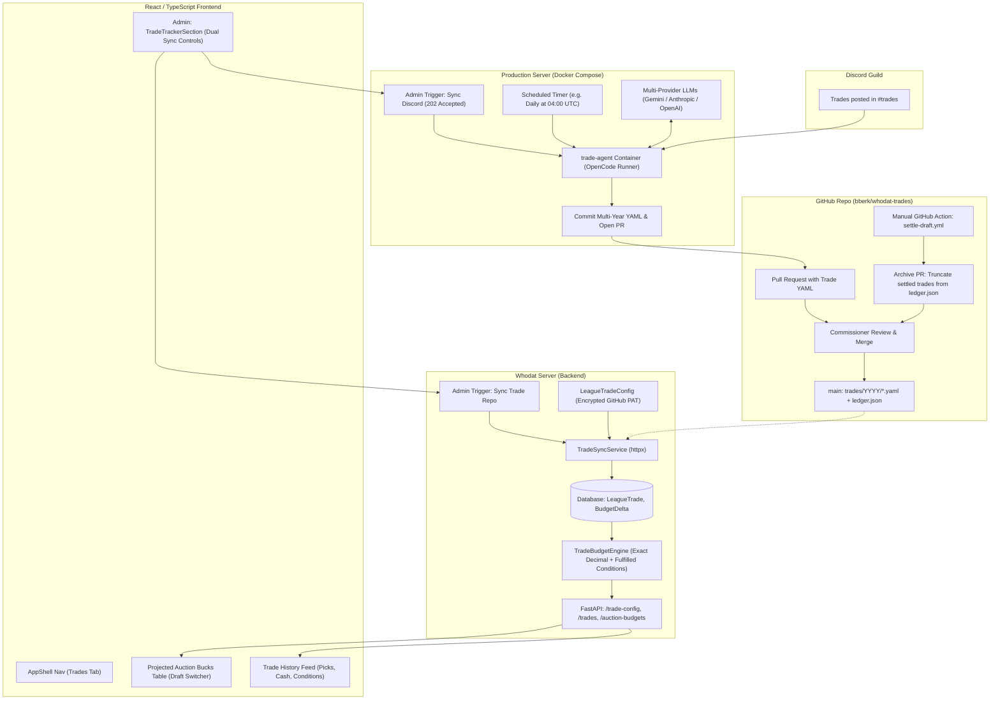
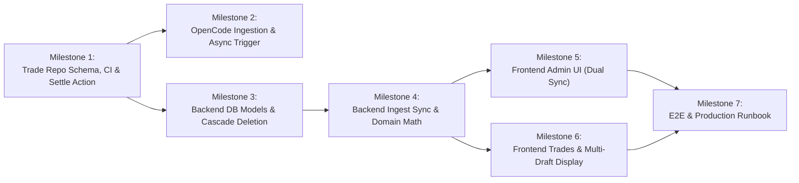

# Implementation Plan: Discord Trade Tracker & Projected Auction Bucks

**Branch:** `discord_trade_tracker_plan`
**Status:** Architecture Approved / Enhanced with Independent Review Findings
**Target Systems:** Discord, `bberk/whodat-trades` (GitHub), Production Server (OpenCode), `whodat-server` (Backend & Frontend)

---

## 1. Executive Summary & High-Level Architecture

Fantasy football dynasty and keeper leagues frequently trade future assets—most notably **auction draft dollars** and **future draft picks**—via Discord text chat in channels like `#trades`. In many leagues, trades involve assets across **multiple future draft years** (for example: *Team A sends Mahomes + a 2027 1st round pick + $5 in 2027 and $10 in 2028 to Team B for Justin Jefferson*). Fantasy platforms like ESPN do not support multi-year future auction budgets, draft pick tracking, or trade ledgers.

This feature introduces an end-to-end, opt-in **Trade Tracker & Projected Auction Bucks Display** system:
1. **Discord Ingestion & AI Parsing via OpenCode Sidecar**: An automated agent running in an isolated Docker container on the production server uses an **OpenCode** installation (configured with multi-provider LLM access) to fetch `#trades` messages, extract structured multi-draft trades, picks, and conditional clauses, and submit them as Pull Requests to a dedicated Git repository (`bberk/whodat-trades`).
2. **Dual-Trigger Asynchronous Execution**: The ingestion job runs on a daily schedule and can also be triggered on-demand by an administrator directly from the `whodat-server` Admin Page (**"Sync Discord Trades"**) via an asynchronous, non-blocking `202 Accepted` queue.
3. **Human-in-the-Loop Review**: League commissioners or managers review the PR diff on GitHub for accuracy and merge it into `main`.
4. **Versioned Trade Repo & Post-Draft PR Truncation**:
   - Immutable historical trade YAML files are kept permanently in `trades/YYYY/*.yaml`.
   - After each season's draft, a manual GitHub Action (`settle-draft.yml` via `workflow_dispatch`) runs a truncation script that opens a Pull Request to retire fully executed trades from `ledger.json` while keeping multi-year trades with future obligations active.
5. **Whodat Server Sync**: The `whodat-server` backend fetches the merged `ledger.json` from GitHub using an encrypted token (triggered periodically or on-demand via **"Sync Trade Repo"** in the Admin UI), calculates each team's net auction dollars adjustment for any target draft year (including fulfilled conditional clauses), and computes projected auction budgets.
6. **Website Display**: The frontend displays an interactive **Projected Auction Bucks Table** (with draft year switcher and multi-draft indicators) alongside an audited **Trade History Feed** (showing players, picks, cash, and conditions), with full admin controls for budget baselines, sync triggers, and team alias mapping.

### End-to-End System Architecture



---

## 2. Subsystem 1: Discord AI Trade Extraction Engine via OpenCode

### 2.1 Execution Environment & Sidecar Architecture

Per `docs/DEPLOY_SERVER.md` §13, backend containers must never have access to host sockets or Docker daemons. To maintain clean isolation without host security compromises, OpenCode runs as a dedicated **sidecar container** inside `deploy/server/docker-compose.yml`:

```yaml
trade-agent:
  image: ghcr.io/bberk/whodat-trade-agent:latest # or built locally from deploy/server/Dockerfile.trade-agent
  restart: unless-stopped
  environment:
    - DISCORD_BOT_TOKEN=${DISCORD_BOT_TOKEN}
    - GH_TOKEN=${TRADE_REPO_GH_TOKEN}
    - GEMINI_API_KEY=${GEMINI_API_KEY}
    - ANTHROPIC_API_KEY=${ANTHROPIC_API_KEY}
    - OPENAI_API_KEY=${OPENAI_API_KEY}
  volumes:
    - trade_repo_data:/workspace
  networks:
    - internal
```

- **Communication**: The backend triggers the agent via an internal lightweight HTTP endpoint (`POST http://trade-agent:8080/sync-discord?league_id={id}`) protected by an internal shared secret.
- **Concurrency Mutex**: A file lock (`/workspace/.sync.lock`) prevents multiple jobs from running simultaneously and causing `git index.lock` corruption.

### 2.2 Asynchronous Dual Trigger Modes

1. **Scheduled Daily Timer**: An internal timer inside the container triggers extraction at 04:00 UTC daily.
2. **Admin On-Demand Trigger**:
   - Route: `POST /api/v1/leagues/{league_id}/trades/discord-sync`.
   - **Asynchronous Response**: Returns `202 Accepted` immediately:
     ```json
     { "status": "queued", "message": "Discord AI ingestion started in background" }
     ```
   - Sets `league_trade_config.discord_sync_status = "running"`.
   - Upon completion, updates `discord_sync_status = "idle"` and `last_discord_sync_at = now()`, or records error details in `last_discord_sync_error`.

### 2.3 Discord Ingestion & Idempotent Deduplication

- **Watermark Cursor**: Persisted in `.watermark.json` on `main`:
  ```json
  {
    "channel_id": "123456789012345678",
    "last_message_id": "130458923485723490",
    "last_sync_timestamp": "2026-11-07T18:00:00Z"
  }
  ```
- **Idempotency Guard**:
  To prevent duplicate PRs if a scheduled sync runs while a prior PR is still pending:
  Before opening a PR for an extracted trade, the agent checks:
  1. Does `trades/**/*.yaml` on `main` already contain `source.message_id`?
  2. Does an open PR (`gh pr list --state open --json body,headRefName`) already reference `source.message_id`?
  If either is true, the trade is skipped as already in progress.

### 2.4 Multi-Draft, Asset & Pick Extraction Schema

Trades frequently divide auction money across multiple draft years and include draft picks alongside players:
*Example:* **"Alice trades Mahomes + 2027 1st round pick + $5 in 2027 and $10 in 2028 to Bob for Justin Jefferson."**

OpenCode produces structured JSON matching the canonical schema:

```json
{
  "trades_found": [
    {
      "source_message_id": "130458923485723490",
      "source_jump_url": "https://discord.com/channels/.../...",
      "timestamp": "2026-11-07T16:30:00Z",
      "confirmed": true,
      "agreement_season": 2026,
      "parties": [
        {
          "team_name": "Team Alice",
          "discord_author": "alice_ff",
          "players_sent": ["Patrick Mahomes"],
          "players_received": ["Justin Jefferson"],
          "draft_picks_sent": [
            { "draft_year": 2027, "round": 1, "original_team": "Team Alice" }
          ],
          "draft_picks_received": [],
          "auction_dollars": [
            { "draft_year": 2027, "amount": -5.00 },
            { "draft_year": 2028, "amount": -10.00 }
          ]
        },
        {
          "team_name": "Team Bob",
          "discord_author": "bob_commish",
          "players_sent": ["Justin Jefferson"],
          "players_received": ["Patrick Mahomes"],
          "draft_picks_sent": [],
          "draft_picks_received": [
            { "draft_year": 2027, "round": 1, "original_team": "Team Alice" }
          ],
          "auction_dollars": [
            { "draft_year": 2027, "amount": 5.00 },
            { "draft_year": 2028, "amount": 10.00 }
          ]
        }
      ],
      "conditions": [
        {
          "id": "cond-1",
          "description": "If Mahomes wins MVP in 2026, Bob pays Alice an extra $5 in 2028",
          "draft_year": 2028,
          "potential_amount": 5.00,
          "paying_team": "Team Bob",
          "receiving_team": "Team Alice",
          "status": "pending"
        }
      ],
      "raw_text": "Alice: Mahomes + 2027 1st + $5 2027 + $10 2028 for Justin Jefferson\nBob: Deal"
    }
  ]
}
```

---

## 3. Subsystem 2: Trade Repository Architecture (`bberk/whodat-trades`)

### 3.1 Adopted Structure: Hybrid Option 3 with Prunable Working Ledger

```
trades/
  2025/
    2025-10-12_cmc_picks.yaml
  2026/
    2026-11-07_mahomes_jefferson.yaml
    2026-11-20_henry_cash.yaml
ledger.json          <-- Active/unsettled trades + draft balances
.watermark.json      <-- Discord ingestion cursor
```

- **`trades/` directory (Permanent History)**: Keeps every trade YAML permanently. Trade files are **never deleted**. This serves as the unalterable audit log of all transactions in league history.
- **`ledger.json` (Active Working Ledger)**: The lightweight index consumed by `whodat-server`. Only contains trades that have **active / unsettled obligations** for current or future drafts.

### 3.2 Canonical Trade Schema (`trades/YYYY/YYYY-MM-DD_<slug>.yaml`)

```yaml
version: 1
id: "2026-11-07-alice-bob"
date: "2026-11-07T16:30:00Z"
agreement_season: 2026
source:
  platform: "discord"
  channel: "trades"
  message_id: "130458923485723490"
  jump_url: "https://discord.com/channels/123/456/130458923485723490"
parties:
  - team_name: "Team Alice"
    discord_user: "alice_ff"
    players_sent:
      - name: "Patrick Mahomes"
        position: "QB"
        nfl_team: "KC"
    players_received:
      - name: "Justin Jefferson"
        position: "WR"
        nfl_team: "MIN"
    draft_picks_sent:
      - draft_year: 2027
        round: 1
        original_team: "Team Alice"
    draft_picks_received: []
    auction_dollars:
      - draft_year: 2027
        amount: -5.00
      - draft_year: 2028
        amount: -10.00
  - team_name: "Team Bob"
    discord_user: "bob_commish"
    players_sent:
      - name: "Justin Jefferson"
        position: "WR"
        nfl_team: "MIN"
    players_received:
      - name: "Patrick Mahomes"
        position: "QB"
        nfl_team: "KC"
    draft_picks_sent: []
    draft_picks_received:
      - draft_year: 2027
        round: 1
        original_team: "Team Alice"
    auction_dollars:
      - draft_year: 2027
        amount: 5.00
      - draft_year: 2028
        amount: 10.00
conditions:
  - id: "cond-1"
    description: "If Patrick Mahomes wins MVP, Team Bob pays extra $5 in 2028"
    draft_year: 2028
    paying_team: "Team Bob"
    receiving_team: "Team Alice"
    amount: 5.00
    status: "pending" # pending | fulfilled | void
notes: |
  Agreed in #trades on Nov 7, 2026.
```

### 3.3 Zero-Sum Constraint Per Draft Year
CI validates that for **every distinct `draft_year`** in a trade:
$$\forall Y \in \text{DraftYears}, \quad \sum_{p \in \text{parties}} \text{auction\_dollars}(p, Y) = 0$$
Auction money cannot be created or destroyed in any draft year.

### 3.4 Canonical `ledger.json` Specification

`ledger.json` is generated by CI on merge to `main`. It contains active trades, settled IDs, and precomputed balances:

```json
{
  "version": 1,
  "last_compiled_at": "2026-11-07T18:00:00Z",
  "settle_through_year": 2026,
  "active_draft_years": [2027, 2028],
  "settled_trade_ids": ["2025-10-12-cmc-picks"],
  "active_trades": [
    {
      "id": "2026-11-07-alice-bob",
      "date": "2026-11-07T16:30:00Z",
      "agreement_season": 2026,
      "parties": [ ... ],
      "conditions": [ ... ]
    }
  ],
  "projected_balances": {
    "2027": { "Team Alice": "-5.00", "Team Bob": "5.00" },
    "2028": { "Team Alice": "-10.00", "Team Bob": "10.00" }
  }
}
```

### 3.5 Post-Draft Settling & PR Truncation Workflow

After each season's draft:
1. **Manual Action Trigger**: Commissioner triggers `settle-draft.yml` via `workflow_dispatch` with parameter `settle_through_year: 2026`.
2. **Pruning Logic**:
   - A trade ID is moved to `settled_trade_ids` and removed from `active_trades` **only if** all its draft years $\le 2026$ **and** all conditions are resolved (`status: fulfilled` or `void`).
   - Trades with future obligations (e.g. 2027 or 2028 dollars) remain in `active_trades`.
3. **PR Created**: Opens PR `archive/settle-draft-2026` for commissioner review and merge.

---

## 4. Subsystem 3: Whodat Server Integration Architecture

### 4.1 Database Models & Migration (`0012_trade_tracker.py`)

Adjustments are stored in normalized tables with cascading deletes:

```python
"""Add league trade tracking and multi-draft auction budget tables."""

# Tables:
# 1. league_trade_config
#    - league_id (FK league.id ON DELETE CASCADE, UNIQUE)
#    - enabled (Boolean, default False)
#    - discord_channel_id (Text, nullable)
#    - repo_owner (Text, default "bberk")
#    - repo_name (Text, default "whodat-trades")
#    - branch (Text, default "main")
#    - github_token_encrypted (Text, nullable)
#    - base_auction_budget (Numeric(10, 2), default 200.00)
#    - team_aliases (JSON, default {})
#    - last_synced_at (DateTime(timezone=True), nullable)
#    - last_sync_commit (Text, nullable)
#    - last_sync_status (Text, default "idle") # idle | syncing | error
#    - last_sync_error (Text, nullable)
#    - last_discord_sync_at (DateTime(timezone=True), nullable)
#    - discord_sync_status (Text, default "idle") # idle | running | error
#    - last_discord_sync_error (Text, nullable)

# 2. league_trade
#    - id (Integer, PK)
#    - league_id (FK league.id ON DELETE CASCADE)
#    - external_trade_id (Text) # e.g. "2026-11-07-alice-bob"
#    - date (DateTime(timezone=True))
#    - agreement_season (Integer) # e.g. 2026
#    - is_settled (Boolean, default False)
#    - discord_url (Text, nullable)
#    - summary (Text)
#    - raw_yaml (Text)
#    - conditions (JSON, default [])
#    - uq_league_trade (league_id, external_trade_id)

# 3. league_trade_party
#    - id (Integer, PK)
#    - trade_id (FK league_trade.id ON DELETE CASCADE)
#    - owner_id (FK owner.id ON DELETE SET NULL, nullable)
#    - franchise_key (Text, nullable) # e.g. "espn:7" for owner turnover continuity
#    - team_name_raw (Text)
#    - players_sent (JSON, default [])
#    - players_received (JSON, default [])
#    - draft_picks_sent (JSON, default [])
#    - draft_picks_received (JSON, default [])

# 4. league_trade_budget_delta
#    - id (Integer, PK)
#    - party_id (FK league_trade_party.id ON DELETE CASCADE)
#    - league_id (FK league.id ON DELETE CASCADE)
#    - draft_year (Integer) # e.g. 2027 or 2028
#    - amount (Numeric(10, 2)) # signed delta (e.g. -5.00, +10.00)
#    - ix_budget_delta (league_id, draft_year)
```

### 4.2 Cascading Deletions in `LeagueService.delete_league()`
Per project constraints, Postgres enforces child-first deletions. In `LeagueService.delete_league()`, trade tables are deleted before `Owner`:
$$\text{budget\_delta} \rightarrow \text{trade\_party} \rightarrow \text{trade} \rightarrow \text{trade\_config} \rightarrow \text{UserLeague} \rightarrow \text{Owner} \rightarrow \dots$$

### 4.3 Domain Calculation Engine (`app.domain.trade_budget`)

Pure standard-library module with 100% test coverage using exact `Decimal` arithmetic.
**Critical Fix:** Integrates fulfilled conditional amounts into the confirmed Net Delta:

For a target draft year $Y$ and team $i$:
$$\text{Base Delta}_i(Y) = \sum_{d \in \text{Deltas}(i, Y)} d.\text{amount}$$
$$\text{Fulfilled Conds}_i(Y) = \sum_{c \in \text{Fulfilled}(i, Y, \text{recv})} c.\text{amount} - \sum_{c \in \text{Fulfilled}(i, Y, \text{pay})} c.\text{amount}$$
$$\text{Net Delta}_i(Y) = \text{Base Delta}_i(Y) + \text{Fulfilled Conds}_i(Y)$$
$$\text{Projected Budget}_i(Y) = \text{base\_auction\_budget} + \text{Net Delta}_i(Y)$$
$$\text{Pending Conditional Delta}_i(Y) = \sum_{c \in \text{Pending}(i, Y, \text{recv})} c.\text{amount} - \sum_{c \in \text{Pending}(i, Y, \text{pay})} c.\text{amount}$$

- If $\text{Projected Budget}_i(Y) < 0$, the response flags `is_negative_budget: true` with an alert badge.
- All numbers are serialized as decimal strings (e.g. `"195.00"`).

### 4.4 API Contract & Schemas

| Method | Endpoint | Auth | Description |
| :--- | :--- | :--- | :--- |
| `GET` | `/leagues/{league_id}/trade-config` | Admin | Trade settings, sync statuses, and alias map (`has_github_token: bool`). |
| `PUT` | `/leagues/{league_id}/trade-config` | Admin | Update repo, channel ID, token, base budget, and aliases. |
| `POST` | `/leagues/{league_id}/trades/discord-sync` | Admin | Asynchronously triggers OpenCode Discord ingestion (`202 Accepted`). |
| `POST` | `/leagues/{league_id}/trades/sync` | Admin | Ingests merged `ledger.json` from GitHub into database. |
| `GET` | `/leagues/{league_id}/trades` | Member | List trade history log with filters (team, draft year, players, picks). |
| `GET` | `/leagues/{league_id}/auction-budgets?draft_year={year}` | Member | Table of projected auction budgets for the specified draft year. |

---

## 5. Subsystem 4: Frontend UI & User Experience

### 5.1 AppShell Navigation
- `LeagueSummary` includes `has_trades_enabled: bool`.
- When true, `AppShell.tsx` renders the **Trades** tab:
  `Standings | History | Trades | Owner | Admin`
- Route: `/leagues/:leagueId/trades`.
- The global `SeasonPicker` is hidden on `/trades` (consistent with `/owner` and `/history`).

### 5.2 Admin Settings Panel (`TradeTrackerSection.tsx`)
In `AdminPage.tsx`:
- Opt-in feature toggle.
- Discord Channel ID input.
- GitHub repo coordinates (`bberk/whodat-trades`, branch `main`).
- GitHub PAT (write-only, masked when saved).
- Base starting budget input (default `$200.00`).
- **Franchise & Alias Mapping Tool**: Associates Discord handles or past team names with canonical league owners/franchises (ensuring continuity when owners change).
- **Dual Sync Action Controls**:
  1. **"Run Discord AI Ingestion"**: Calls `POST .../trades/discord-sync`. Shows status: `Queued / Running` $\rightarrow$ `PR Created`.
  2. **"Sync Trade Repo Now"**: Calls `POST .../trades/sync`. Shows status: `Synced commit 8c2f1d`.

### 5.3 Trades & Auction Page (`TradesPage.tsx`)

#### View 1: Projected Auction Bucks Table
- **Draft Year Picker**: Toggle pills (e.g. `2027 Draft ($)`, `2028 Draft ($)`).
- **Responsive Table**:
  - **Team / Owner** (sticky on mobile).
  - **Starting Budget** (\$200.00).
  - **Net Trade Delta** (e.g., `-$5.00` in red or `+$15.00` in green, including fulfilled conditions).
  - **Projected Budget** (e.g., **`$195.00`** in bold; highlighted with amber badge if negative).
  - **Pending Conditions** (badge with popover: e.g. `+$5 pending MVP`).
  - **Active Trades Count**.
- Clicking a team row opens a modal/drawer showing every trade contributing to that team's delta.

#### View 2: Trade History Feed
- Searchable by player or draft pick and filterable by team or draft year.
- **Interactive Multi-Draft Indicator Pills**:
  - If a trade spans multiple drafts, trade cards show interactive pills (e.g., `[Also includes -$10 in 2028 Draft]`).
  - Clicking the pill switches the page's draft year filter directly to 2028.
- Each trade card displays:
  - Date and Discord jump permalink.
  - Multi-draft asset breakdown:
    - Players exchanged.
    - Draft picks exchanged (e.g. `2027 1st Round Pick`).
    - Auction cash transfers (e.g. `💸 2027: $5.00 from Alice to Bob`).
  - Conditional clauses with status badge (`Pending`, `Fulfilled`, `Void`).
  - Expandable Discord message quote.

---

## 6. Implementation Roadmap for Workers



### Milestone 1: Trade Repository, Schema & Post-Draft Action (`bberk/whodat-trades`)
- [ ] Create repository `bberk/whodat-trades`.
- [ ] Implement multi-draft YAML trade schema including `draft_picks`.
- [ ] Implement GitHub Actions CI:
  - Validates zero-sum balance rule for **each individual draft year**.
  - Auto-compiles `ledger.json` on merge to `main`.
- [ ] Implement `settle-draft.yml` manual GitHub Action (`workflow_dispatch`) that runs `scripts/compile_ledger.py --settle-through <year>` and opens an archive PR.

### Milestone 2: Production Server OpenCode Ingestion & Async Trigger API
- [ ] Add `trade-agent` sidecar definition in `deploy/server/docker-compose.yml`.
- [ ] Configure multi-provider LLM settings in `deploy/server/.env.example` (Gemini, Anthropic, OpenAI).
- [ ] Implement Discord message fetcher with `.watermark.json` cursor and PR deduplication guard.
- [ ] Implement OpenCode trade extraction prompt with multi-draft JSON schema.
- [ ] Implement git commit and PR opening automation.
- [ ] Implement backend endpoint `POST /api/v1/leagues/{league_id}/trades/discord-sync` returning `202 Accepted`.

### Milestone 3: Whodat Backend Models, Migrations & Cascade Deletion
- [ ] Alembic migration `0012_trade_tracker.py` for `league_trade_config`, `league_trade`, `league_trade_party`, `league_trade_budget_delta`.
- [ ] SQLAlchemy models in `backend/src/app/db/models.py`.
- [ ] Update `LeagueService.delete_league()` to clean up trade tables child-first on Postgres.
- [ ] Add `has_trades_enabled` to `LeagueSummary`.
- [ ] AES-256-GCM encryption verification for GitHub PAT.

### Milestone 4: Backend Domain Engine, GitHub Sync Service & API Endpoints
- [ ] Implement pure domain logic in `backend/src/app/domain/trade_budget.py` (including fulfilled conditions, exact `Decimal` math, 100% coverage).
- [ ] Implement `TradeSyncService` in `backend/src/app/services/trade_sync_service.py` with alias resolution and idempotent upsert.
- [ ] Implement schemas and endpoints in `routes_trades.py` (`/trade-config`, `/trades`, `/auction-budgets`, `/sync`).
- [ ] Update `docs/openapi.json`.

### Milestone 5: Frontend Admin Settings & Dual Sync Controls
- [ ] Regenerate frontend API types with `pnpm gen:api`.
- [ ] Add `TradeTrackerSection.tsx` to `AdminPage.tsx` with separate **"Run Discord AI Ingestion"** and **"Sync Trade Repo"** buttons.
- [ ] Add conditional `Trades` navigation tab in `AppShell.tsx` and hide `SeasonPicker` on `/trades`.
- [ ] Unit tests for admin trade tracker configuration and alias mapper.

### Milestone 6: Frontend Trades & Projected Auction Bucks Page
- [ ] Implement `frontend/src/pages/TradesPage.tsx`.
- [ ] Implement `ProjectedAuctionTable.tsx` with draft year switcher, mobile sticky column, and negative budget alerts.
- [ ] Implement `TradeLogFeed.tsx` with draft picks, multi-year cash badges, interactive multi-draft indicator pills, player search, and filters.
- [ ] Implement loading, empty, and error states.

### Milestone 7: End-to-End Verification & Production Runbook
- [ ] Write integration tests for multi-draft trades, fulfilled conditions, cascade deletion, and sync rate limits.
- [ ] Verify pre-commit hooks (`ruff`, `mypy`, `vitest`).
- [ ] Document production server OpenCode sidecar setup and `settle-draft.yml` workflow in `docs/DEPLOY_SERVER.md`.
