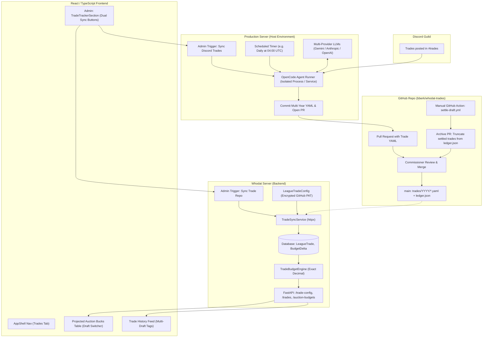
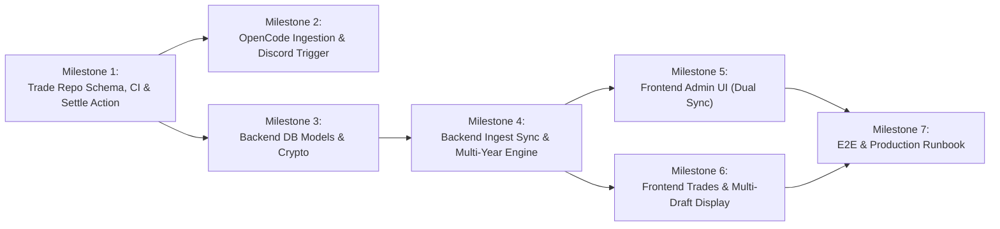

# Implementation Plan: Discord Trade Tracker & Projected Auction Bucks

**Branch:** `discord_trade_tracker_plan`
**Status:** Finalized Draft / Approved Architecture
**Target Systems:** Discord, `bberk/whodat-trades` (GitHub), Production Server (OpenCode), `whodat-server` (Backend & Frontend)

---

## 1. Executive Summary & High-Level Architecture

Fantasy football dynasty and keeper leagues frequently trade future assets—most notably **auction draft dollars** and future draft picks—via Discord text chat in channels like `#trades`. In many leagues, trades involve assets across **multiple future draft years** (for example: *Team A sends Mahomes + $5 in 2027 + $10 in 2028 to Team B for Justin Jefferson*). Fantasy platforms like ESPN do not support multi-year future auction budgets or trade ledgers.

This feature introduces an end-to-end, opt-in **Trade Tracker & Projected Auction Bucks Display** system:
1. **Discord Ingestion & AI Parsing via OpenCode on Production Server**: An automated agent running separately on the production server uses an **OpenCode** installation (configured with multi-provider LLM access) to fetch `#trades` messages, extract structured multi-draft trades and conditional clauses, and submit them as Pull Requests to a dedicated Git repository (`bberk/whodat-trades`).
2. **Dual-Trigger Execution**: The ingestion job runs on a daily schedule and can also be triggered on-demand by an administrator directly from the `whodat-server` Admin Page (**"Sync Discord Trades"**).
3. **Human-in-the-Loop Review**: League commissioners or managers review the PR diff on GitHub for accuracy and merge it into `main`.
4. **Versioned Trade Repo & Post-Draft PR Truncation**:
   - Immutable historical trade YAML files are kept permanently in `trades/YYYY/*.yaml`.
   - After each season's draft, a manual GitHub Action (`workflow_dispatch`) runs a truncation script that opens a Pull Request to retire fully executed trades from `ledger.json` while keeping multi-year trades with future obligations active.
5. **Whodat Server Sync**: The `whodat-server` backend fetches the merged `ledger.json` from GitHub using an encrypted token (triggered periodically or on-demand via **"Sync Trade Repo"** in the Admin UI), calculates each team's net auction dollars adjustment for any target draft year, and computes projected auction budgets.
6. **Website Display**: The frontend displays an interactive **Projected Auction Bucks Table** (with draft year switcher and multi-draft indicators) alongside an audited **Trade History Feed**, with full admin controls for budget baselines, sync triggers, and team alias mapping.

### End-to-End System Architecture



---

## 2. Subsystem 1: Discord AI Trade Extraction Engine via OpenCode

### 2.1 Execution Environment & Isolation

The extraction engine runs on the production Linux server (described in `docs/DEPLOY_SERVER.md`) as an **isolated service** separate from the core uvicorn backend.

#### Deployment Options:
- **Option A (Recommended): Isolated Systemd Service on Host**:
  - OpenCode installed in `/opt/opencode` or via virtualenv on the host OS.
  - Managed via `whodat-trade-agent.service` and `whodat-trade-agent.timer`.
  - The FastAPI backend can trigger execution asynchronously on-demand via a controlled local command or systemd socket without blocking the web process.
- **Option B: Dedicated Sidecar Container in `docker-compose.yml`**:
  - `trade-agent` service with OpenCode CLI, Python 3.12, `git`, and `gh` installed.
  - Communicates with the backend via internal Docker network or IPC.

#### Multi-Provider LLM Configuration:
OpenCode reads provider configurations from `deploy/server/.env`:
```json
{
  "default_provider": "gemini",
  "providers": {
    "gemini": {
      "model": "gemini-2.0-flash",
      "api_key_env": "GEMINI_API_KEY",
      "temperature": 0.1
    },
    "anthropic": {
      "model": "claude-3-5-sonnet-latest",
      "api_key_env": "ANTHROPIC_API_KEY",
      "temperature": 0.1
    },
    "openai": {
      "model": "gpt-4o",
      "api_key_env": "OPENAI_API_KEY",
      "temperature": 0.1
    }
  }
}
```
If Gemini hits a rate limit or service interruption, OpenCode automatically falls back to Anthropic or OpenAI.

### 2.2 Dual Trigger Modes

1. **Scheduled Daily Timer**: Runs automatically (e.g. daily at 04:00 UTC) to pick up new trades announced overnight.
2. **Admin On-Demand Trigger**:
   - The admin can click **"Run Discord AI Ingestion"** in the web interface.
   - Route: `POST /api/v1/leagues/{league_id}/trades/discord-sync`.
   - Triggers the OpenCode worker in the background, immediately fetching any messages posted since the last sync watermark.

### 2.3 Discord Ingestion & Watermarking

- **Watermark Persistence**: `.watermark.json` stored in the working clone of `bberk/whodat-trades`:
  ```json
  {
    "channel_id": "123456789012345678",
    "last_message_id": "130458923485723490",
    "last_sync_timestamp": "2026-11-07T18:00:00Z"
  }
  ```
- **Context Gathering**: Fetches messages forward from `last_message_id`. Gathers trade proposals, replies (e.g. "Accepted"), and emoji reactions (e.g. `white_check_mark`, `thumbsup`) to confirm mutual agreement before extracting.

### 2.4 Multi-Draft Extraction Schema

Trades frequently divide auction money across several upcoming draft years.
*Example:* **"Alice trades Mahomes + $5 in 2027 and $10 in 2028 to Bob for Justin Jefferson."**

OpenCode produces structured JSON matching the multi-draft contract:

```json
{
  "trades_found": [
    {
      "source_message_id": "130458923485723490",
      "source_jump_url": "https://discord.com/channels/.../...",
      "timestamp": "2026-11-07T16:30:00Z",
      "confirmed": true,
      "agreement_season": 2026,
      "parties": [
        {
          "team_name": "Team Alice",
          "discord_author": "alice_ff",
          "players_sent": ["Patrick Mahomes"],
          "players_received": ["Justin Jefferson"],
          "auction_dollars": [
            { "draft_year": 2027, "amount": -5.00 },
            { "draft_year": 2028, "amount": -10.00 }
          ]
        },
        {
          "team_name": "Team Bob",
          "discord_author": "bob_commish",
          "players_sent": ["Justin Jefferson"],
          "players_received": ["Patrick Mahomes"],
          "auction_dollars": [
            { "draft_year": 2027, "amount": 5.00 },
            { "draft_year": 2028, "amount": 10.00 }
          ]
        }
      ],
      "conditions": [
        {
          "id": "cond-1",
          "description": "If Mahomes wins MVP in 2026, Bob pays Alice an extra $5 in 2028",
          "draft_year": 2028,
          "potential_amount": 5.00,
          "paying_team": "Team Bob",
          "receiving_team": "Team Alice",
          "status": "pending"
        }
      ],
      "raw_text": "Alice: Patrick Mahomes + $5 2027 + $10 2028 for Justin Jefferson\nBob: Deal"
    }
  ]
}
```

### 2.5 PR Creation Automation

When valid trades are parsed:
1. OpenCode creates a git branch in the local clone of `bberk/whodat-trades`: `trade/sync-YYYY-MM-DD-HHMM`.
2. Writes the trade YAML file to `trades/<agreement_season>/<date>_<slug>.yaml`.
3. Updates `.watermark.json`.
4. Pushes the branch to GitHub using `GH_TOKEN`.
5. Opens a Pull Request via `gh pr create` with asset exchange tables broken down by draft year, raw Discord quotes, and reviewer assignment.

---

## 3. Subsystem 2: Trade Repository Architecture (`bberk/whodat-trades`)

### 3.1 Adopted Structure: Hybrid Option 3 with Prunable Working Ledger

```
trades/
  2025/
    2025-10-12_cmc_picks.yaml
  2026/
    2026-11-07_mahomes_jefferson.yaml
    2026-11-20_henry_cash.yaml
ledger.json          <-- Active/unsettled trades + draft balances
.watermark.json      <-- Discord ingestion cursor
```

- **`trades/` directory (Permanent History)**: Keeps every trade YAML permanently. Trade files are **never deleted**. This serves as the unalterable audit log of all transactions in league history.
- **`ledger.json` (Active Working Ledger)**: The lightweight index consumed by `whodat-server`. Only contains trades that have **active / unsettled obligations** for current or future drafts.
- **Merge Conflict Freedom**: New trades are submitted as independent files in `trades/`, so multiple PRs never conflict with one another.

### 3.2 Canonical Trade Schema (`trades/YYYY/YYYY-MM-DD_<slug>.yaml`)

```yaml
version: 1
id: "2026-11-07-alice-bob"
date: "2026-11-07T16:30:00Z"
agreement_season: 2026
source:
  platform: "discord"
  channel: "trades"
  message_id: "130458923485723490"
  jump_url: "https://discord.com/channels/123/456/130458923485723490"
parties:
  - team_name: "Team Alice"
    discord_user: "alice_ff"
    players_sent:
      - name: "Patrick Mahomes"
        position: "QB"
        nfl_team: "KC"
    players_received:
      - name: "Justin Jefferson"
        position: "WR"
        nfl_team: "MIN"
    auction_dollars:
      - draft_year: 2027
        amount: -5.00
      - draft_year: 2028
        amount: -10.00
  - team_name: "Team Bob"
    discord_user: "bob_commish"
    players_sent:
      - name: "Justin Jefferson"
        position: "WR"
        nfl_team: "MIN"
    players_received:
      - name: "Patrick Mahomes"
        position: "QB"
        nfl_team: "KC"
    auction_dollars:
      - draft_year: 2027
        amount: 5.00
      - draft_year: 2028
        amount: 10.00
conditions:
  - id: "cond-1"
    description: "If Patrick Mahomes wins MVP, Team Bob pays extra $5 in 2028"
    draft_year: 2028
    paying_team: "Team Bob"
    receiving_team: "Team Alice"
    amount: 5.00
    status: "pending" # pending | fulfilled | void
notes: |
  Agreed in #trades on Nov 7, 2026.
```

### 3.3 Zero-Sum Constraint Per Draft Year
CI validates that for **every distinct `draft_year`** in a trade:
$$\forall Y \in \text{DraftYears}, \quad \sum_{p \in \text{parties}} \text{auction\_dollars}(p, Y) = 0$$
Auction money cannot be created or destroyed in any draft year.

### 3.4 Post-Draft Settling & PR Truncation Workflow

After each season's fantasy draft completes (typically late August):
1. **Manual GitHub Action Trigger**:
   - Commissioner navigates to the Actions tab in `bberk/whodat-trades` and triggers `settle-draft.yml` via `workflow_dispatch`.
   - Input: `settle_through_year: 2026`.
2. **Truncation Script Execution**:
   - The workflow runs `python scripts/compile_ledger.py --settle-through 2026`.
   - **Pruning Logic**:
     - A trade is removed from `ledger.json` **only** if all of its `draft_year` entries are $\le 2026$ **and** all its conditions are resolved.
     - Multi-year trades with future obligations (e.g., 2027 or 2028 dollars remaining) remain active in `ledger.json`.
   - **Archival Snapshot**: Writes an archival snapshot `archives/ledger_2026.json`.
3. **Automated PR Creation**:
   - The Action creates a new branch `archive/settle-draft-2026` and opens a PR titled:
     `Archive: Settle Draft 2026 and Prune Executed Trades`.
   - PR description lists all fully settled trades being retired and summarizes active future balances.
   - The commissioner reviews the diff and clicks **Merge**.

---

## 4. Subsystem 3: Whodat Server Integration Architecture

### 4.1 Database Models & Alembic Migration (`0012_trade_tracker.py`)

Adjustments are stored in a normalized child table `league_trade_budget_delta`:

```python
"""Add league trade tracking and multi-draft auction budget tables."""

# Tables:
# 1. league_trade_config
#    - league_id (FK league.id, UNIQUE)
#    - enabled (Boolean, default False)
#    - repo_owner (Text, e.g. "bberk")
#    - repo_name (Text, e.g. "whodat-trades")
#    - branch (Text, default "main")
#    - github_token_encrypted (Text, nullable)
#    - base_auction_budget (Numeric(10, 2), default 200.00)
#    - team_aliases (JSON, default {})
#    - last_synced_at (DateTime(timezone=True), nullable)
#    - last_sync_commit (Text, nullable)
#    - last_sync_status (Text, default "idle")
#    - last_sync_error (Text, nullable)

# 2. league_trade
#    - id (Integer, PK)
#    - league_id (FK league.id)
#    - external_trade_id (Text) # e.g. "2026-11-07-alice-bob"
#    - date (DateTime(timezone=True))
#    - agreement_season (Integer) # e.g. 2026
#    - is_settled (Boolean, default False)
#    - discord_url (Text, nullable)
#    - summary (Text)
#    - raw_yaml (Text)
#    - conditions (JSON, default [])
#    - uq_league_trade (league_id, external_trade_id)

# 3. league_trade_party
#    - id (Integer, PK)
#    - trade_id (FK league_trade.id, ON DELETE CASCADE)
#    - owner_id (FK owner.id, nullable)
#    - team_name_raw (Text)
#    - players_sent (JSON)
#    - players_received (JSON)

# 4. league_trade_budget_delta
#    - id (Integer, PK)
#    - party_id (FK league_trade_party.id, ON DELETE CASCADE)
#    - league_id (FK league.id)
#    - draft_year (Integer) # e.g. 2027 or 2028
#    - amount (Numeric(10, 2)) # signed delta (e.g. -5.00, +10.00)
#    - ix_budget_delta (league_id, draft_year)
```

### 4.2 GitHub Sync Service (`TradeSyncService`)

Located at `backend/src/app/services/trade_sync_service.py`:
1. **GitHub Ingestion**: Reads `ledger.json` from the configured repository using the decrypted token.
2. **Alias Resolution**:
   - Matches raw trade names to canonical league `Owner` records.
   - Falls back to `league_trade_config.team_aliases` mapping.
3. **Database Upsert**:
   - Idempotently upserts trades and budget deltas based on `(league_id, external_trade_id)`.
   - When a trade is retired from `ledger.json` via draft archival, `whodat-server` marks existing database records as `is_settled = True` instead of deleting them.
4. **Rate Limiting**:
   - Ingest sync is rate-limited to max 1 sync per 30 seconds per league.

### 4.3 Domain Calculation Engine (`app.domain.trade_budget`)

Pure standard-library module with 100% test coverage using exact `Decimal` arithmetic:
- **Starting Budget**: `base_auction_budget` (e.g., \$200.00).
- **For a selected `target_draft_year` (e.g., 2027)**:
  $$\text{Net Delta}_i(Y) = \sum_{t \in \text{Trades}} \sum_{d \in t.\text{deltas}(i, Y)} d.\text{amount}$$
  $$\text{Projected Budget}_i(Y) = \text{Starting Budget} + \text{Net Delta}_i(Y)$$
  $$\text{Pending Conditional Delta}_i(Y) = \sum_{c \in \text{PendingConditions}(i, Y)} c.\text{amount}$$

### 4.4 API Endpoints

| Method | Endpoint | Auth | Description |
| :--- | :--- | :--- | :--- |
| `GET` | `/leagues/{league_id}/trade-config` | Admin | Trade tracker settings, sync status, and team mappings. |
| `PUT` | `/leagues/{league_id}/trade-config` | Admin | Update repo, token, base budget, and aliases. |
| `POST` | `/leagues/{league_id}/trades/discord-sync` | Admin | Trigger OpenCode Discord AI ingestion on production server. |
| `POST` | `/leagues/{league_id}/trades/sync` | Admin | Trigger GitHub trade repo ingest into whodat-server. |
| `GET` | `/leagues/{league_id}/trades` | Member | List trade history log with filters (team, draft year). |
| `GET` | `/leagues/{league_id}/auction-budgets?draft_year={year}` | Member | Table of projected auction budgets for the specified draft year. |

---

## 5. Subsystem 4: Frontend UI & User Experience

### 5.1 AppShell Navigation
- When `selectedLeague.has_trades_enabled === true`, the navigation header displays **Trades**:
  `Standings | History | Trades | Owner | Admin`
- Route: `/leagues/:leagueId/trades`.

### 5.2 Admin Settings Panel (`TradeTrackerSection.tsx`)
In `AdminPage.tsx`:
- Opt-in feature toggle.
- GitHub repo coordinates (`bberk/whodat-trades`, branch `main`).
- GitHub PAT (write-only, masked when saved).
- Base starting budget input (default `$200.00`).
- **Team Alias Mapping Tool**: Table showing unmapped names extracted from recent trades with a dropdown selector to assign them to official League Owners.
- **Dual Sync Action Controls**:
  1. **"Run Discord AI Ingestion"**: Triggers OpenCode on the server to scan `#trades` and open a PR on GitHub.
  2. **"Sync Trade Repo Now"**: Ingests the merged `ledger.json` from GitHub into the server's database.

### 5.3 Trades & Auction Page (`TradesPage.tsx`)

#### View 1: Projected Auction Bucks Table
- **Draft Year Picker**: Dropdown / toggle pills (e.g. `2027 Draft ($)`, `2028 Draft ($)`).
- **Responsive Table**:
  - **Team / Owner** (sticky on mobile).
  - **Starting Budget** (\$200.00).
  - **Net Trade Delta** (e.g., `-$5.00` in red or `+$15.00` in green).
  - **Projected Budget** (e.g., **`$195.00`** in bold).
  - **Pending Conditions** (badge with popover: e.g. `+$5 pending MVP`).
  - **Active Trades Count**.
- Clicking a team row opens a modal/drawer showing every trade contributing to that team's delta for the selected draft year.

#### View 2: Trade History Feed
- Searchable by player and filterable by team or draft year.
- **Multi-Draft Indicator Pills**:
  - If a trade spans multiple drafts, trade cards show interactive pills (e.g., `[Also includes -$10 in 2028 Draft]`).
  - Clicking the pill switches the page's draft year filter directly to 2028.
- Each trade card displays:
  - Date and Discord permalink button.
  - Multi-draft asset breakdown (players + \$ per draft year).
  - Explicit badges for cash transfers:
    - `💸 2027: $5.00 from Alice to Bob`
    - `💸 2028: $10.00 from Alice to Bob`
  - Conditional clauses with status badge (`Pending`, `Fulfilled`, `Void`).
  - Expandable Discord message quote.

---

## 6. Implementation Roadmap for Workers



### Milestone 1: Trade Repository, Schema & Post-Draft Action (`bberk/whodat-trades`)
- [ ] Create repository `bberk/whodat-trades`.
- [ ] Implement multi-draft YAML trade schema.
- [ ] Implement GitHub Actions CI:
  - Validates zero-sum balance rule for **each individual draft year**.
  - Auto-compiles `ledger.json` on merge to `main`.
- [ ] Implement `settle-draft.yml` manual GitHub Action (`workflow_dispatch`) that runs `scripts/compile_ledger.py --settle-through <year>` and opens an archive PR.

### Milestone 2: Production Server OpenCode Ingestion & Trigger API
- [ ] Add `whodat-trade-agent` service definition with OpenCode CLI on production host.
- [ ] Configure multi-provider LLM settings in `deploy/server/.env` (Gemini primary, Anthropic fallback).
- [ ] Implement Discord message fetcher with `.watermark.json` cursor.
- [ ] Implement OpenCode trade extraction prompt with multi-draft JSON schema.
- [ ] Implement git commit and PR opening automation.
- [ ] Implement backend endpoint `POST /api/v1/leagues/{league_id}/trades/discord-sync` to trigger the OpenCode worker.

### Milestone 3: Whodat Backend Models, Migrations & Encryption
- [ ] Alembic migration `0012_trade_tracker.py` for `league_trade_config`, `league_trade`, `league_trade_party`, `league_trade_budget_delta`.
- [ ] SQLAlchemy models in `backend/src/app/db/models.py`.
- [ ] AES-256-GCM encryption verification for GitHub PAT.
- [ ] Database repositories and queries for draft-year-filtered trade data.

### Milestone 4: Backend Domain Engine, GitHub Sync Service & API Endpoints
- [ ] Implement pure domain logic in `backend/src/app/domain/trade_budget.py` (exact `Decimal` math, 100% coverage).
- [ ] Implement `TradeSyncService` in `backend/src/app/services/trade_sync_service.py` with alias resolution and idempotent upsert.
- [ ] Implement schemas and endpoints in `routes_trades.py` (`/trade-config`, `/trades`, `/auction-budgets`, `/sync`).
- [ ] Update `docs/openapi.json`.

### Milestone 5: Frontend Admin Settings & Dual Sync Controls
- [ ] Regenerate frontend API types with `pnpm gen:api`.
- [ ] Add `TradeTrackerSection.tsx` to `AdminPage.tsx` with separate **"Run Discord AI Ingestion"** and **"Sync Trade Repo"** buttons.
- [ ] Add conditional `Trades` navigation tab in `AppShell.tsx`.
- [ ] Unit tests for admin trade tracker configuration and alias mapper.

### Milestone 6: Frontend Trades & Projected Auction Bucks Page
- [ ] Implement `frontend/src/pages/TradesPage.tsx`.
- [ ] Implement `ProjectedAuctionTable.tsx` with draft year switcher and mobile sticky column.
- [ ] Implement `TradeLogFeed.tsx` with multi-year cash badges, interactive multi-draft indicator pills, player search, and filters.
- [ ] Implement loading, empty, and error states.

### Milestone 7: End-to-End Verification & Production Runbook
- [ ] Write integration tests for multi-draft trades, post-draft settling, and sync rate limits.
- [ ] Verify pre-commit hooks (`ruff`, `mypy`, `vitest`).
- [ ] Document production server OpenCode setup and `settle-draft.yml` workflow in `docs/DEPLOY_SERVER.md`.
